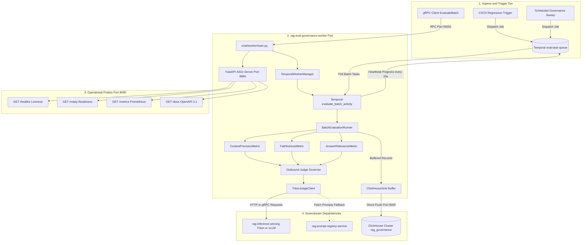
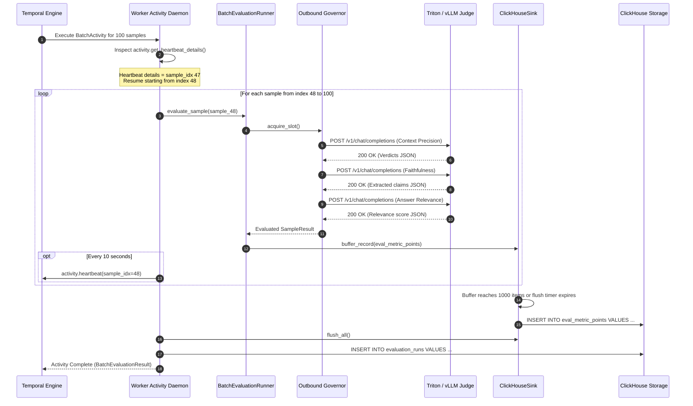

# Architectural Specification — RAG Evaluation & Governance Worker (`rag-eval-governance-worker`)

> **Authoritative References**:
> - [RAG Evaluation and Governance Worker Plan.pdf](tasks/RAG%20Evaluation%20and%20Governance%20Worker%20Plan.pdf)
> - [Production Grade Backend Concepts.pdf](tasks/Production%20Grade%20Backend%20Concepts.pdf)
> - [Disaggregated Hybrid Model Architecture.pdf](tasks/Disaggregated%20Hybrid%20Model%20Architecture.pdf)
> - [GEMINI Master Directive](GEMINI.MD)
> - [Microservice Documented API ("Doc API")](.ai/doc-api.md)

---

## 1. Executive Summary & Architectural Positioning

The **`rag-eval-governance-worker`** (Evaluation & Quality Worker) is a stateless, horizontally autoscaling batch compute microservice operating within the horizontal execution tier of the Multimodal RAG enterprise platform. 

It is designed to solve four critical operational challenges in enterprise RAG systems:
1. **Decoupled Batch Execution ([ADR-001](#adr-001-separation-of-ingestion-sanitization-from-offline-evaluation))**: Isolates heavy, asynchronous LLM-as-a-judge evaluation pipelines from the real-time chunk tokenization and streaming sanitization path (`rag-masking-sanitizer`), eliminating queue cross-talk, memory starvation, and scaling interference.
2. **Standardized Lean Evaluation Engine ([ADR-002](#adr-002-native-metric-prompts-over-ragastrulens-dependencies))**: Eliminates runtime dependencies on bloated third-party evaluation frameworks (Ragas, TruLens) in favor of lightweight, version-controlled prompt templates executed directly against Triton / vLLM inference gateways (`rag-inference-serving`).
3. **Unified Micro-Batched Persistence ([ADR-003](#adr-003-clickhouse-unified-persistence))**: Replaces transactional dual-writes to relational databases (PostgreSQL) with direct client-side micro-batched ingestion into ClickHouse `ReplacingMergeTree` tables (`evaluation_runs` and `eval_metric_points`).
4. **Deterministic Fault Isolation & Resumption**: Orchestrated via Temporal Python SDK (`temporalio`) with per-sample progress heartbeating every 10 seconds, enabling zero-recompute resumption upon pod preemption and quarantining corrupt samples to a Dead-Letter Queue (DLQ).

```
[ Ingestion Path ]
Raw Chunks ──► [ rag-masking-sanitizer ] (CPU / Stream) ──► [ rag-inference-serving ] (Triton)
                     │
                     ▼ (Tier 1 Regex/Aho-Corasick ──► Tier 2 High-Entropy NLP ──► KMS-Salted HMAC)

[ Offline Eval Path ]
CI/CD Triggers / Traces ──► [ Temporal Queue: eval-task-queue ] ──► [ rag-eval-governance-worker ]
                                                                             │
                    ┌────────────────────────────────────────────────────────┴─────────────────────────────────┐
                    ▼                                                                                          ▼
       Egress Judge Rate Limiter                                                                        ClickHouse Sink
   (Token-Bucket / Concurrency Semaphores)                                                       (Direct Micro-Batched Insert)
                    │                                                                                          │
                    ▼                                                                                          ▼
       [ rag-inference-serving ] / External LLM                                                  evaluation_runs & eval_metric_points
```

---

## 2. Calibrated Quantitative SLOs & SLIs

Aligned with the authoritative specifications in [RAG Evaluation and Governance Worker Plan.pdf](tasks/RAG%20Evaluation%20and%20Governance%20Worker%20Plan.pdf):

| Metric Dimension | Service Level Objective (SLO) | Measurement Method / SLI | Enforcement Mechanism |
| :--- | :--- | :--- | :--- |
| **Batch Evaluation Turnaround** | **$P95 \le 180\text{s}$** for a 100-sample golden-set evaluation run | Prometheus histogram `eval_batch_duration_seconds` | Concurrency semaphore capped at 20 in-flight judge requests per pod |
| **Sample Judge Latency** | **$P99 \le 5.0\text{s}$** per single metric evaluation | Prometheus histogram `eval_sample_execution_latency_seconds` | 45-second HTTP timeout, connection pooling (`httpx.Limits(max_connections=20)`) |
| **Heartbeat Reliability** | **100%** of activity tasks heartbeat every 10 seconds per evaluated sample | Temporal activity heartbeat timestamp delta | Periodic heartbeat checkpointing with current `sample_idx` |
| **Preemption Resumption** | **At-least-once replay with zero duplicate judge calls for checkpointed samples**; durable deduplication via ClickHouse `ReplacingMergeTree` | Verified via simulated SIGKILL at sample 47 resuming at sample 48 with completed indices skipped | Temporal `activity.get_heartbeat_details()` state inspection & ClickHouse deduplication |
| **Memory Ceiling** | **Flat RSS $\le 2.0\text{ GiB}$** under continuous prolonged execution | Container cgroup memory metrics / `soak_test_memory.py` | `jemalloc` (`LD_PRELOAD=/usr/lib/x86_64-linux-gnu/libjemalloc.so.2`) |
| **Quality Gate Threshold** | **$\tau \ge 0.82$** for Faithfulness, Context Precision, and Relevance | CI/CD regression verification script (`scripts/trigger_regression_gate.py`) | Automated blocking of canary releases violating threshold |
| **ClickHouse Batch Insert** | **Insert latency $\le 1.0\text{s}$** with zero part fragmentation | Client-side buffer timer / ClickHouse system parts | 1,000-record / 1.0s buffer flush threshold |

---

## 3. End-to-End System Topologies & Interaction Flow

### A. Overall Topology



### B. Sample-Level Evaluation & Heartbeat Resumption Sequence



---

## 4. Production-Grade 5-Layer Backend Architecture

Aligned with [Production Grade Backend Concepts.pdf](tasks/Production%20Grade%20Backend%20Concepts.pdf):

### Layer 1: API, Routing & Interface

- **Entrypoint Bootstrap ([`cmd/worker/main.py`](cmd/worker/main.py))**:
  - Initializes runtime environment, validates 12-factor configuration via Pydantic [Settings](internal/config/settings.py), establishes ClickHouse client pools, and bootstraps the Temporal activity worker daemon.
  - Hosts the internal FastAPI ASGI server concurrently via `asyncio.TaskGroup` on port `8080`.
  - Exposes gRPC service `rag.eval.v1.EvaluationWorkerService` on port `50051` via Protobuf v3 contracts ([`api/proto/v1/eval_worker.proto`](api/proto/v1/eval_worker.proto)).
- **Documentation & Operational Probe Endpoints**:
  - `GET /docs`: Interactive Swagger UI powered by OpenAPI 3.1.
  - `GET /redoc`: Interactive ReDoc UI documentation.
  - `GET /api/docs` & `GET /openapi.json`: Machine-readable OpenAPI 3.1 JSON specification.
  - `GET /healthz`: Liveness probe verifying the worker event loop is healthy.
  - `GET /ready`: Readiness probe verifying ClickHouse connectivity, judge endpoint reachability, and Temporal queue polling.
  - `GET /metrics`: Prometheus telemetry scrape endpoint.
- **Request Tracing & Middleware**:
  - ULID-based request tracing headers propagated through all probe requests and activity invocations.
  - Structured request logging middleware capturing processing duration, tenant context, and status codes.
- **Input Validation**:
  - Strict Pydantic v2 domain schemas ([`internal/evaluation/models.py`](internal/evaluation/models.py)) validating batches, sample items, context passages, and judge responses.
- **Idempotency & Replay**:
  - Work is strictly identified and keyed by `(tenant_id, run_id, sample_idx)`. Checkpoint resumption skips previously checkpointed samples to prevent duplicate judge calls, while in-flight samples follow at-least-once replay with durable deduplication in ClickHouse via `ReplacingMergeTree`.

---

### Layer 2: Data Persistence & State (ADR-003)

- **ClickHouse Unified Persistence ([ADR-003](#adr-003-clickhouse-unified-persistence))**:
  - Completely eliminates transactional dual-writes to relational databases. PostgreSQL is entirely removed from the runtime topology.
  - **Table `evaluation_runs`**: Stores high-level batch execution metadata, aggregate metric scores, sample counts, and execution status:
    ```sql
    CREATE TABLE IF NOT EXISTS rag_governance.evaluation_runs (
        tenant_id LowCardinality(String),
        run_id UUID,
        dataset_id String,
        created_at DateTime64(6, 'UTC'),
        completed_at Nullable(DateTime64(6, 'UTC')),
        status LowCardinality(String),
        total_samples UInt32,
        evaluated_samples UInt32,
        failed_samples UInt32,
        mean_faithfulness Nullable(Float64),
        mean_context_precision Nullable(Float64),
        mean_answer_relevance Nullable(Float64),
        judge_model LowCardinality(String),
        execution_duration_ms UInt64,
        attempt UInt32 DEFAULT 1
    )
    ENGINE = ReplacingMergeTree(attempt)
    PARTITION BY toYYYYMM(created_at)
    ORDER BY (tenant_id, run_id);
    ```
  - **Table `eval_metric_points`**: Stores granular sample-level point-in-time metric evaluations:
    ```sql
    CREATE TABLE IF NOT EXISTS rag_governance.eval_metric_points (
        tenant_id LowCardinality(String),
        run_id UUID,
        sample_idx UInt32,
        sample_id String,
        metric_name LowCardinality(String),
        score Float64,
        passed UInt8,
        reasoning_hash FixedString(64),
        execution_latency_ms UInt32,
        created_at DateTime64(6, 'UTC')
    )
    ENGINE = ReplacingMergeTree(created_at)
    PARTITION BY toYYYYMM(created_at)
    ORDER BY (tenant_id, run_id, metric_name, sample_idx);
    ```
- **Read-Time Deduplication Contract**:
  - `ReplacingMergeTree` executes background deduplication asynchronously. All downstream readers, quality gates, and analytical queries MUST query using `FINAL` or an explicit version-aware query:
    ```sql
    SELECT * FROM rag_governance.eval_metric_points FINAL
    WHERE tenant_id = 'acme_corp' AND run_id = '...';
    ```
- **Direct Micro-Batching Buffer ([`internal/storage/clickhouse_sink.py`](internal/storage/clickhouse_sink.py))**:
  - High-throughput asynchronous client buffer accumulates metric records in-memory.
  - Flushes to ClickHouse when buffer reaches `CLICKHOUSE_BATCH_SIZE` (1,000 records) or `CLICKHOUSE_FLUSH_INTERVAL_SECONDS` (1.0s), preventing the creation of excessive detached parts.
- **Forensic Hash Integrity**:
  - ClickHouse persists the full 64-character SHA-256 digest (`FixedString(64)`), providing a tamper-proof forensic audit trail while application logs redact it to 16 characters (`[:16]`).

---

### Layer 3: Architecture & Scale

- **Temporal Task Queues & Activity Worker**:
  - Dedicated task queue: `eval-task-queue`.
  - Batch evaluation DAG workflows decompose large golden sets into activity executions with heartbeat supervision.
  - Activity worker daemon ([`internal/temporal/worker.py`](internal/temporal/worker.py)) provides structured lifecycle shutdown handling OS signals (`SIGTERM`, `SIGINT`).
- **KEDA Event-Driven Horizontal Autoscaling**:
  - Worker pods scale dynamically based on Temporal activity backlog depth in Prometheus:
    ```yaml
    # deployments/helm/templates/scaledobject.yaml
    apiVersion: keda.sh/v1alpha1
    kind: ScaledObject
    spec:
      minReplicaCount: 1
      maxReplicaCount: 8
      pollingInterval: 15
      cooldownPeriod: 300
      triggers:
        - type: prometheus
          metadata:
            serverAddress: http://prometheus-k8s.monitoring.svc.cluster.local:9090
            metricName: temporal_activity_backlog
            threshold: "5"
            query: sum(temporal_activity_task_queue_backlog{task_queue="eval-task-queue"})
    ```
- **Multi-Pod Judge Capacity Budgeting**:
  - Each pod enforces a local concurrency semaphore (`JUDGE_MAX_CONCURRENT_REQUESTS=20`) and rate limiter (`50 RPS`).
  - Across peak autoscaling (8 replicas), aggregate downstream demand can reach 160 concurrent connections and 400 RPS. Fleet sizing must be budgeted proportionally against downstream Triton / vLLM serving capacity.

---

### Layer 4: Security, Tenant Isolation & Governance

- **Tenant Isolation**:
  - Strict tenant boundary: Every evaluation payload requires a valid `tenant_id`. All ClickHouse storage partitions and queries are indexed by `tenant_id`.
- **Zero Plaintext Secrets**:
  - HashiCorp Vault / AWS KMS integration dynamically manages credentials and tenant salts. Secrets reside purely in volatile heap memory and are never serialized to disk.
- **Secured Logging Invariant**:
  - All logs emitted across `cmd/`, `internal/`, and `scripts/` are formatted as structured JSON.
  - **Mandatory Redaction**: Raw customer queries, retrieved document passages, golden-set ground truth texts, generated model answers, authorization headers, and presigned URLs are strictly scrubbed prior to log emission.
  - Diagnostic logs record only truncated SHA-256 hashes (`reasoning_hash[:16]`), execution latencies, sample indexes, and numerical metric scores.
- **Container Hardening**:
  - Runs as unprivileged non-root user (`USER 1000:1000`).
  - Container filesystem is mounted read-only (`readOnlyRootFilesystem: true`) with ephemeral mounts on `/tmp`.

---

### Layer 5: Observability, Resilience & Chaos Hardening

- **Prometheus Telemetry Matrix**:
  - `eval_batch_duration_seconds`: Histogram measuring total batch run durations.
  - `eval_sample_execution_latency_seconds`: Histogram measuring single sample judge evaluation latency.
  - `eval_judge_active_concurrency`: Gauge measuring current in-flight judge queries against the cap (20).
  - `eval_judge_rate_limit_errors_total`: Counter tracking downstream HTTP 429 and `RESOURCE_EXHAUSTED` responses.
  - `eval_metric_score_value`: Gauge tracking calculated metric score values across dimensions.
- **Outbound Judge Governor ([`internal/evaluation/ratelimiter.py`](internal/evaluation/ratelimiter.py))**:
  - **Token Bucket Rate Limiter**: 50.0 tokens/second guarded by `asyncio.Lock` eliminating concurrency stampedes.
  - **Concurrency Semaphore**: Bound to 20 concurrent requests per pod.
  - **Exponential Backoff with Full Jitter**: Backoff calculation on HTTP 429:
    $$\text{delay} = \text{random}(0, \min(30.0, 1.0 \times 2^{\text{retry\_count}}))$$
  - **Circuit Breaker**: Trips to `OPEN` state after 5 consecutive failures. Pauses egress for 30 seconds before testing downstream reachability with a single probe request in `HALF-OPEN` state.
- **Sample-Level DLQ & Fault Isolation**:
  - Corrupt, unparseable, or persistently failing samples exceeding retry budgets are isolated to a Dead-Letter Queue (DLQ) and increment `failed_samples_count`.
  - Poison-pill samples never crash the batch activity; the evaluator continues processing remaining valid samples.

---

## 5. Detailed Evaluation Metric Engineering (ADR-002)

To avoid the package dependency bloat, unconstrained heap growth, and version deadlocks of Ragas and TruLens, the worker implements standardized native prompt evaluators:

### A. Context Precision

Measures retrieval rank quality and signal-to-noise ratio: whether the retrieved context passages most relevant to answering the query are ranked higher than irrelevant passages.

1. **Evaluation**: For each retrieved chunk $k \in \{1, \dots, K\}$, the judge determines binary relevance $v_k \in \{0, 1\}$ to the user query and ground truth.
2. **Mathematical Formulation**: Evaluates Mean Average Precision (MAP):
   $$\text{Context Precision@K} = \frac{\sum_{k=1}^K (\text{Precision@}k \times v_k)}{\sum_{k=1}^K v_k}$$
   where $\text{Precision@}k = \frac{\sum_{i=1}^k v_i}{k}$.

### B. Faithfulness / Groundedness

Measures whether the generated answer is strictly grounded in and derived from the retrieved context passages, eliminating hallucinations.

1. **Step 1 (Claim Extraction)**: The LLM judge extracts all atomic, standalone factual assertions $\{c_1, c_2, \dots, c_N\}$ made in the answer.
2. **Step 2 (Grounding Verification)**: For each claim $c_i$, the judge verifies whether it can be directly inferred from the retrieved contexts ($g_i \in \{0, 1\}$) and identifies the supporting citation index.
3. **Mathematical Formulation**:
   $$\text{Faithfulness} = \frac{\sum_{i=1}^N g_i}{N}$$

### C. Answer Relevance

Measures whether the generated answer directly addresses the user's prompt without introducing irrelevant, tangential, or redundant content.

1. **Evaluation**: Evaluates bidirectional semantic alignment between the prompt and generated answer on a normalized scale $[0.0, 1.0]$.
2. **Validation**: Deducts score penalties for answers that refuse to answer unnecessarily, evade the question, or include extraneous commentary.

### D. Defensive JSON Schema Parsing

The judge client enforces structured JSON output (`response_format={"type": "json_object"}`). To protect against non-standard LLM generation artifacts, the parser includes defensive sanitization:
- Strips surrounding markdown backticks (e.g. ```` ```json ... ``` ````).
- Validates payload against Pydantic schema models.
- Gracefully quarantines invalid syntax to the sample DLQ.

---

## 6. Runtime Memory Optimization & Systems Sizing

### Memory Management via `jemalloc`

Python's default `glibc` memory allocator suffers from severe virtual memory arena fragmentation when frequently allocating, concatenating, and discarding large JSON strings and prompts. Under prolonged batch execution, this causes unbounded Resident Set Size (RSS) growth even when objects are garbage-collected.

**Solution**:
- All production containers preload `jemalloc`:
  ```dockerfile
  # deployments/docker/Dockerfile
  RUN apt-get update && apt-get install -y --no-install-recommends libjemalloc2
  ENV LD_PRELOAD=/usr/lib/x86_64-linux-gnu/libjemalloc.so.2
  ```
- **Result**: Eliminates heap fragmentation, maintaining flat RSS $\le 2.0\text{ GiB}$ over 12-hour continuous soak test runs.

### Kubernetes Node & Pod Sizing Blueprint

| Resource Dimension | Specification | Rationale |
| :--- | :--- | :--- |
| **Node Architecture** | AWS `c6i.2xlarge` (8 vCPU, 16 GiB RAM) | Compute-optimized nodes maximize JSON parsing, regex evaluation, and async network I/O throughput. |
| **CPU Requests / Limits** | `2,000m` / `4,000m` | Guarantees 2 dedicated cores for event loop and async tasks; allows burst to 4 cores during peak JSON deserialization. |
| **Memory Requests / Limits** | `2.0 GiB` / `3.5 GiB` | Calibrated memory ceiling; accommodates in-flight buffers and ClickHouse batches with safety margin below node capacity. |
| **Memory Allocator** | `libjemalloc.so.2` | Flat RSS guarantees zero OOMKilled evictions during long-running golden-set batches. |

---

## 7. Architectural Decision Records (ADRs)

### ADR-001: Separation of Ingestion Sanitization from Offline Evaluation
- **Status**: Accepted
- **Context**: Real-time chunk ingestion requires sub-120ms stream processing (regex, Aho-Corasick, NLP entity masking). Offline evaluation runs heavy, bursty LLM-as-a-judge batches taking minutes. Combining both in a single service caused queue cross-talk, memory contention, and worker preemption.
- **Decision**: Decouple real-time stream tokenization into `rag-masking-sanitizer` and offline batch evaluation into `rag-eval-governance-worker`.
- **Consequences**: Independent horizontal autoscaling profiles, isolated failure domains, and simplified dependency trees.

### ADR-002: Native Metric Prompts over Ragas/TruLens Dependencies
- **Status**: Accepted
- **Context**: Third-party evaluation frameworks (Ragas, TruLens) introduce deep dependency trees (LangChain, HuggingFace, heavy PyTorch runtimes), resulting in unconstrained heap growth (>6 GiB RSS) and package version conflicts.
- **Decision**: Implement native, version-controlled prompt templates for Context Precision, Faithfulness, and Answer Relevance executed directly against Triton / vLLM endpoints via structured JSON schemas.
- **Consequences**: Lightweight pod footprint (RSS $\le 2.0$ GiB), zero third-party framework lock-in, and full control over prompt engineering and latency budgets.

### ADR-003: ClickHouse Unified Persistence
- **Status**: Accepted
- **Context**: Traditional architectures perform dual-writes: run metadata to relational PostgreSQL and point-in-time metrics to time-series/OLAP stores. This introduces distributed transaction failure modes and synchronization lag.
- **Decision**: Persist both execution run headers (`evaluation_runs`) and sample-level metric points (`eval_metric_points`) directly into ClickHouse using `ReplacingMergeTree` engines with client-side micro-batching.
- **Consequences**: Zero relational database dual-writes, high-speed analytical aggregation, and unified time-series queries. Readers must follow the `FINAL` deduplication contract.

### ADR-004: Tiered PII/PHI Processing & Stream Isolation
- **Status**: Accepted
- **Context**: Real-time token sanitization must handle high-throughput streams without running expensive Transformer NER models on every chunk.
- **Decision**: Confine all PII/PHI tokenization to `rag-masking-sanitizer` using a two-tier strategy (Tier 1 Aho-Corasick/Regex fast-path, Tier 2 Presidio fallback strictly on high-entropy spans).
- **Consequences**: Evaluator worker processes purely clean, authenticated textual spans without holding token hashing master keys.

---

## 8. Operational Runbooks & Incident Response

### Runbook 1: Downstream Judge Saturation Remediation
- **Symptom**: Prometheus counter `rate(eval_judge_rate_limit_errors_total[5m]) > 0` or circuit breaker trips `OPEN`.
- **Diagnosis**: Downstream Triton/vLLM inference pool (`rag-inference-serving`) is overloaded by concurrent batch evaluation traffic.
- **Remediation**:
  1. Inspect active concurrency: `sum(eval_judge_active_concurrency)`.
  2. Dynamically reduce per-pod concurrency cap via ConfigMap or Helm:
     ```yaml
     JUDGE_MAX_CONCURRENT_REQUESTS: "10"
     JUDGE_RATE_LIMIT_RPS: "25.0"
     ```
  3. Verify Temporal activity timeouts: Ensure `start_to_close_timeout` allows batch queues to drain gracefully under backpressure without timing out.

### Runbook 2: Quality Gate CI/CD Rejection Troubleshooting
- **Symptom**: CI/CD pipeline fails at `scripts/trigger_regression_gate.py` with exit code 1 (one or more metrics below $\tau = 0.82$).
- **Diagnosis**: Prompt regression, retrieval candidate degradation, or corrupted test fixtures.
- **Remediation**:
  1. Query ClickHouse to isolate underperforming samples:
     ```sql
     SELECT sample_id, metric_name, score, execution_latency_ms
     FROM rag_governance.eval_metric_points FINAL
     WHERE run_id = '<FAILED_RUN_ID>' AND score < 0.82
     ORDER BY score ASC;
     ```
  2. If **Faithfulness** degraded: inspect whether recent generation prompt changes caused model answers to extrapolate beyond retrieved context.
  3. If **Context Precision** degraded: inspect whether search index updates or reranker parameter adjustments affected top-$K$ retrieval ordering.

### Runbook 3: Activity Heartbeat Stalling & Preemption Recovery
- **Symptom**: Prometheus alert `ActivityHeartbeatStalling` fires (heartbeat delta $> 25\text{s}$).
- **Diagnosis**: Evaluator worker thread is blocked on a hung network socket or event loop freeze.
- **Remediation**:
  1. Verify pod liveness probe: `curl -f http://<pod_ip>:8080/healthz`.
  2. If unresponsive, Kubernetes liveness probe will automatically restart the container.
  3. The newly spawned pod will query Temporal for the latest recorded heartbeat (`activity.get_heartbeat_details()`), seamlessly resuming from `sample_idx + 1` with zero duplicate judge queries.
