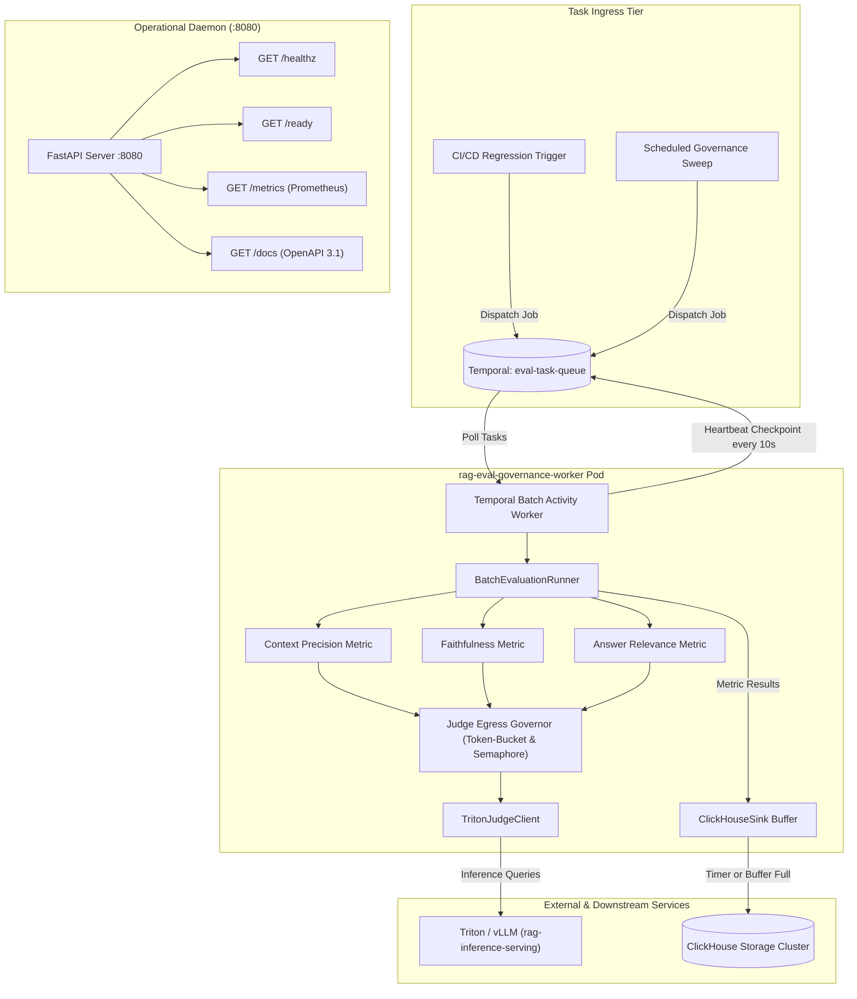

# RAG Evaluation & Governance Worker (`rag-eval-governance-worker`)

[](file:///c:/Users/ANIK/Desktop/Gemejime/Evaluation%20&%20Quality%20Worker/.github/workflows/ci.yml)
[](https://www.python.org/downloads/)
[](file:///c:/Users/ANIK/Desktop/Gemejime/Evaluation%20&%20Quality%20Worker/LICENSE)
[](file:///c:/Users/ANIK/Desktop/Gemejime/Evaluation%20&%20Quality%20Worker/Architecture.md)

`rag-eval-governance-worker` is a stateless, horizontally autoscaling batch compute microservice operating within the horizontal execution tier of the Multimodal RAG platform. It executes offline and asynchronous golden-set evaluation pipelines (Context Precision, Faithfulness / Groundedness, Answer Relevance), governs LLM judge egress with client-side token-bucket rate limiters and concurrency semaphores, micro-batches evaluation records directly into ClickHouse, and guarantees zero-recompute resumption upon pod preemption via Temporal activity heartbeating.

---

## Table of Contents

- [Architectural Overview](#architectural-overview)
- [Key Features & Platform Invariants](#key-features--platform-invariants)
- [System Architecture & Data Flow](#system-architecture--data-flow)
- [Repository Structure](#repository-structure)
- [Configuration & Environment Variables](#configuration--environment-variables)
- [Getting Started & Local Development](#getting-started--local-development)
  - [Prerequisites](#prerequisites)
  - [Installation & Setup](#installation--setup)
  - [Running Tests](#running-tests)
  - [Running the Worker](#running-the-worker)
- [CLI Tooling & Operational Scripts](#cli-tooling--operational-scripts)
- [Containerization & Kubernetes Deployment](#containerization--kubernetes-deployment)
- [Observability, Metrics & Alerts](#observability-metrics--alerts)
- [Documentation & Architectural References](#documentation--architectural-references)

---

## Architectural Overview

As established in [ADR-001](file:///c:/Users/ANIK/Desktop/Gemejime/Evaluation%20&%20Quality%20Worker/Architecture.md#architectural-decision-records-adrs), this repository decouples batch evaluation from real-time stream ingestion:

1. **Stream Ingestion Sanitizer (`rag-masking-sanitizer`)**: Dedicated to real-time chunk tokenization, regex/Aho-Corasick filtering, high-entropy NLP masking, and KMS-salted HMAC hashing on the ingestion path.
2. **Batch Evaluation Worker (`rag-eval-governance-worker`)**: Dedicated to offline golden-set evaluations, LLM-as-a-judge execution, outbound egress governance, and direct ClickHouse audit persistence.

```
[ Ingestion Path ]
Raw Chunks ──► [ rag-masking-sanitizer ] (Stream / Ingestion) ──► [ rag-inference-serving ] (Triton)
                     │
                     ▼ (Aho-Corasick ──► Presidio Fallback ──► KMS HMAC)

[ Offline Eval Path ]
CI/CD Triggers / Traces ──► [ Temporal Queue: eval-task-queue ] ──► [ rag-eval-governance-worker ]
                                                                             │
                    ┌────────────────────────────────────────────────────────┴─────────────────────────────────┐
                    ▼                                                                                          ▼
       Egress Judge Rate Limiter                                                                        ClickHouse Sink
   (Token-Bucket / Concurrency Semaphores)                                                       (Direct Micro-Batched Insert)
                    │                                                                                          │
                    ▼                                                                                          ▼
       [ rag-inference-serving ]                                                                 evaluation_runs & eval_metric_points
```

---

## Key Features & Platform Invariants

- **Standardized Lean Evaluation Engine (ADR-002)**: Replaces bloated third-party evaluation frameworks (Ragas, TruLens) with lightweight, version-controlled prompt templates executed directly against Triton / vLLM inference gateways, eliminating dependency conflicts and unbounded heap growth.
- **Temporal Heartbeat Reliability & Resumption**: Temporal activity workers poll `eval-task-queue` and emit progress heartbeats every 10 seconds containing the current `sample_idx`. Pod preemption resumes execution from the latest acknowledged checkpoint with zero duplicate judge queries.
- **Outbound Judge Egress Governance**: Governs downstream LLM judge capacity using an `asyncio.Lock`-guarded token-bucket rate limiter (50 RPS) and concurrency semaphores (capped at 20 concurrent requests). Includes exponential backoff with full jitter on HTTP 429 / `RESOURCE_EXHAUSTED` and an outbound circuit breaker (tripping after 5 consecutive failures, 30s recovery window).
- **Direct ClickHouse Micro-Batching (ADR-003)**: Eliminates dual-writes to relational databases. Micro-batches run metadata (`evaluation_runs`) and sample-level metric points (`eval_metric_points`) directly into ClickHouse via client-side async buffering (1,000 records or 1.0s flush intervals) using `ReplacingMergeTree` tables.
- **Strict Memory Bounds**: Flat Resident Set Size (RSS) $\le 2.0$ GiB enforced through `jemalloc` (`LD_PRELOAD=/usr/lib/x86_64-linux-gnu/libjemalloc.so.2`) to prevent glibc arena fragmentation during heavy JSON/string manipulation.
- **Continuous OpenAPI & Doc API**: Interactive OpenAPI 3.1 Swagger UI (`/docs`), ReDoc (`/redoc`), raw JSON spec (`/api/docs`, `/openapi.json`), and probes (`/healthz`, `/ready`, `/metrics`) served concurrently on port 8080.
- **Secured Logging Invariant**: Structured JSON logging with automated redaction of sensitive entity text, raw golden-set prompt spans, ground truth passages, and credentials. Truncated 16-character SHA-256 hashes are logged for diagnostics while full 64-character hashes are preserved in ClickHouse for audit trails.

---

## System Architecture & Data Flow



---

## Repository Structure

```
Evaluation & Quality Worker/
├── cmd/
│   └── worker/
│       └── main.py                     # Bootstrap entrypoint hosting ASGI probes & Temporal daemon
├── api/
│   └── proto/v1/
│       ├── eval_worker.proto           # Protobuf v3 gRPC contract for EvaluationWorkerService
│       ├── eval_worker_pb2.py          # Generated Protobuf schema bindings
│       ├── eval_worker_pb2_grpc.py     # Generated gRPC stubs
│       └── eval_worker_pb2.pyi         # MyPy interface stubs
├── internal/
│   ├── config/
│   │   └── settings.py                 # 12-factor Pydantic runtime configuration
│   ├── evaluation/
│   │   ├── models.py                   # Pydantic domain models for batches, samples, metrics
│   │   ├── ratelimiter.py              # Token-bucket rate limiter & circuit breaker governor
│   │   ├── runner.py                   # Async batch runner with sample-level checkpointing
│   │   ├── judges/
│   │   │   ├── base.py                 # Abstract BaseJudgeClient interface
│   │   │   └── triton_client.py        # Native HTTP/gRPC Triton/vLLM judge client
│   │   └── metrics/
│   │       ├── answer_relevance.py     # Query-answer bidirectional semantic relevance evaluator
│   │       ├── context_precision.py    # Binary retrieval rank relevance & MAP evaluator
│   │       └── faithfulness.py         # Atomic claim extraction & groundedness verification
│   ├── storage/
│   │   └── clickhouse_sink.py          # Direct micro-batched ClickHouse ReplacingMergeTree client
│   ├── telemetry/
│   │   ├── metrics.py                  # Prometheus metrics collectors & alert gauges
│   │   └── readiness.py                # Decoupled ReadinessManager for probes
│   └── temporal/
│       ├── activities.py               # Temporal batch evaluation activity with heartbeating
│       ├── worker.py                   # Temporal activity worker lifecycle manager
│       └── workflows.py                # Batch evaluation DAG workflow definitions
├── deployments/
│   ├── docker/
│   │   └── Dockerfile                  # Production container with jemalloc & non-root user
│   ├── helm/
│   │   ├── Chart.yaml                  # Helm microservice chart definition
│   │   ├── values.yaml                 # c6i.2xlarge resource sizing & KEDA autoscale config
│   │   └── templates/
│   │       ├── configmap.yaml          # Environment configuration map
│   │       ├── deployment.yaml         # Kubernetes deployment specification
│   │       ├── rollout.yaml            # Argo Rollouts progressive canary template
│   │       ├── scaledobject.yaml       # KEDA ScaledObject tracking Temporal queue depth
│   │       └── service.yaml            # ClusterIP service definition (8080 / 50051)
│   └── argocd/
│       └── application.yaml            # ArgoCD GitOps declaration
├── scripts/
│   ├── benchmark_throughput.py         # Batch throughput & concurrency benchmark harness
│   ├── compile_proto.py                # Protobuf code generation utility
│   ├── profile_masking_latency.py      # Latency profiler for entity masking
│   ├── simulate_429_chaos.py           # Downstream judge HTTP 429 chaos injector
│   ├── soak_test_memory.py             # 12-hour jemalloc memory leak soak tester
│   └── trigger_regression_gate.py      # CI/CD golden-set quality gate CLI trigger
├── test/
│   ├── fixtures/
│   │   └── golden_set.json             # Reference evaluation golden set
│   ├── integration/
│   │   ├── test_clickhouse_sink.py     # ClickHouse micro-batching integration tests
│   │   ├── test_evaluation_runner.py   # Full pipeline integration tests
│   │   └── test_temporal_activities.py # Temporal activity & heartbeat resumption tests
│   └── unit/
│       ├── test_judges.py              # Native judge adapter & error handling unit tests
│       ├── test_metrics.py             # Context precision, faithfulness, relevance tests
│       ├── test_probes.py              # Healthz, ready, docs, and metrics probe tests
│       ├── test_ratelimiter.py         # Token-bucket & circuit breaker unit tests
│       └── test_settings.py            # Settings parsing & .env.example completeness tests
├── .env.example                        # Production environment template
├── .gitignore                          # Git ignore rules
├── Architecture.md                     # In-depth architectural blueprint
├── GEMINI.MD                           # Master agent directive & development standard
└── pyproject.toml                      # Build metadata, dependencies, Ruff, mypy, pytest config
```

---

## Configuration & Environment Variables

The microservice strictly adheres to 12-factor configuration principles via [Settings](file:///c:/Users/ANIK/Desktop/Gemejime/Evaluation%20&%20Quality%20Worker/internal/config/settings.py). Copy [`.env.example`](file:///c:/Users/ANIK/Desktop/Gemejime/Evaluation%20&%20Quality%20Worker/.env.example) to `.env` for local configuration:

```bash
cp .env.example .env
```

| Variable | Default Value | Description |
| :--- | :--- | :--- |
| `SERVICE_NAME` | `rag-eval-governance-worker` | Microservice identifier for logs and tracing |
| `HOST` | `0.0.0.0` | Bind host address for internal ASGI Doc API / probe server |
| `PORT` | `8080` | Port for FastAPI HTTP probes (`/healthz`, `/ready`, `/metrics`, `/docs`) |
| `GRPC_PORT` | `50051` | Port for internal gRPC `EvaluationWorkerService` |
| `ENVIRONMENT` | `development` | Deployment environment (`development`, `staging`, `production`) |
| `LD_PRELOAD` | `/usr/lib/x86_64-linux-gnu/libjemalloc.so.2` | Path to jemalloc library to eliminate heap fragmentation |
| `TEMPORAL_HOST` | `localhost:7233` | Temporal orchestrator frontend endpoint |
| `TEMPORAL_NAMESPACE` | `default` | Target Temporal namespace |
| `EVAL_TASK_QUEUE` | `eval-task-queue` | Temporal task queue polled by worker |
| `ACTIVITY_HEARTBEAT_INTERVAL_SECONDS` | `10.0` | Activity progress heartbeat emission interval |
| `ACTIVITY_HEARTBEAT_TIMEOUT_SECONDS` | `30.0` | Maximum inactivity duration before heartbeat timeout |
| `JUDGE_ENDPOINT` | `http://localhost:8001` | Triton / vLLM OpenAI-compatible judge server URL |
| `JUDGE_MODEL` | `meta-llama/Llama-3.1-70B-Instruct` | Downstream judge model identifier |
| `JUDGE_MAX_CONCURRENT_REQUESTS` | `20` | Outbound concurrency semaphore cap |
| `JUDGE_RATE_LIMIT_RPS` | `50.0` | Token-bucket rate limiter max queries per second |
| `JUDGE_REQUEST_TIMEOUT_SECONDS` | `45.0` | HTTP request timeout for judge inference calls |
| `JUDGE_429_MAX_RETRIES` | `5` | Maximum retries on HTTP 429 rate limit backpressure |
| `JUDGE_CB_FAILURE_THRESHOLD` | `5` | Consecutive failures required to trip circuit breaker OPEN |
| `JUDGE_CB_RESET_TIMEOUT_SECONDS` | `30.0` | Circuit breaker recovery cooldown period |
| `PROMPT_REGISTRY_URL` | `http://localhost:8080` | Dynamic prompt template registry service endpoint |
| `CLICKHOUSE_HOST` | `localhost` | ClickHouse cluster hostname |
| `CLICKHOUSE_PORT` | `8123` | ClickHouse HTTP port |
| `CLICKHOUSE_USER` | `eval_worker` | ClickHouse database username |
| `CLICKHOUSE_PASSWORD` | `""` | ClickHouse database password |
| `CLICKHOUSE_DATABASE` | `rag_governance` | Target database for evaluation tables |
| `CLICKHOUSE_BATCH_SIZE` | `1000` | Micro-batch flush sample threshold |
| `CLICKHOUSE_FLUSH_INTERVAL_SECONDS` | `1.0` | Periodic timer flush interval in seconds |
| `QUALITY_GATE_MIN_FAITHFULNESS` | `0.82` | Minimum faithfulness score threshold ($\tau$) |
| `QUALITY_GATE_MIN_CONTEXT_PRECISION`| `0.82` | Minimum context precision score threshold ($\tau$) |
| `QUALITY_GATE_MIN_ANSWER_RELEVANCE` | `0.82` | Minimum answer relevance score threshold ($\tau$) |

---

## Getting Started & Local Development

### Prerequisites

- **Python**: Version 3.12 or higher (64-bit).
- **C/C++ Allocator**: `libjemalloc2` installed on Linux systems (`apt-get install libjemalloc2`).
- **Storage & Queues**: ClickHouse instance (HTTP port 8123) and Temporal Server (port 7233).

### Installation & Setup

1. **Clone the repository**:
   ```bash
   git clone https://github.com/Gemejime/rag-eval-governance-worker.git
   cd "Evaluation & Quality Worker"
   ```

2. **Create and activate a virtual environment**:
   ```bash
   python -m venv .venv
   source .venv/bin/activate  # On Windows: .venv\Scripts\activate
   ```

3. **Install dependencies**:
   ```bash
   pip install --upgrade pip
   pip install -e ".[dev,test]"
   ```

4. **Compile Protocol Buffers**:
   ```bash
   python scripts/compile_proto.py
   ```

5. **Initialize configuration**:
   ```bash
   cp .env.example .env
   ```

### Running Tests

Execute the complete test suite with unit, integration, and configuration coverage:

```bash
# Run all unit tests
python -m pytest test/unit -v

# Run integration tests (with mock judge and ClickHouse sinks)
python -m pytest test/integration -v

# Verify code formatting and linting
python -m ruff check .
python -m ruff format --check .

# Run static type verification
python -m mypy cmd internal test
```

### Running the Worker

Launch the combined FastAPI ASGI probe server and Temporal activity worker daemon:

```bash
python -m cmd.worker.main
```

Once running, access the operational endpoints:
- **Interactive Swagger UI**: [http://localhost:8080/docs](http://localhost:8080/docs)
- **Interactive ReDoc UI**: [http://localhost:8080/redoc](http://localhost:8080/redoc)
- **OpenAPI JSON Spec**: [http://localhost:8080/openapi.json](http://localhost:8080/openapi.json)
- **Liveness Probe**: [http://localhost:8080/healthz](http://localhost:8080/healthz)
- **Readiness Probe**: [http://localhost:8080/ready](http://localhost:8080/ready)
- **Prometheus Scrape Endpoint**: [http://localhost:8080/metrics](http://localhost:8080/metrics)

---

## CLI Tooling & Operational Scripts

The [`scripts/`](file:///c:/Users/ANIK/Desktop/Gemejime/Evaluation%20&%20Quality%20Worker/scripts) directory provides standalone operational utilities:

1. **Golden-Set Regression Gate (`scripts/trigger_regression_gate.py`)**:
   Used in CI/CD pipelines to assert quality thresholds ($\tau \ge 0.82$) against a reference golden set:
   ```bash
   python scripts/trigger_regression_gate.py --golden-set test/fixtures/golden_set.json --mock-judge
   ```

2. **Batch Throughput Benchmark (`scripts/benchmark_throughput.py`)**:
   Benchmarks evaluator throughput, latency, and sample heartbeating across synthetic sample counts:
   ```bash
   python scripts/benchmark_throughput.py --samples 100 --concurrency 20 --mock-judge
   ```

3. **Chaos 429 Injection Harness (`scripts/simulate_429_chaos.py`)**:
   Injects synthetic HTTP 429 / `RESOURCE_EXHAUSTED` faults to validate token-bucket backpressure and circuit breaker recovery:
   ```bash
   python scripts/simulate_429_chaos.py --samples 50 --error-rate 0.4
   ```

4. **12-Hour Memory Soak Test (`scripts/soak_test_memory.py`)**:
   Verifies flat memory RSS ($\le 2.0$ GiB) over extended evaluation runs:
   ```bash
   python scripts/soak_test_memory.py --duration-seconds 3600 --iterations 100
   ```

---

## Containerization & Kubernetes Deployment

### Docker Build

Build the hardened, non-root production container:

```bash
docker build -f deployments/docker/Dockerfile -t rag-eval-governance-worker:latest .
```

### Kubernetes & Helm Deployment

The worker is deployed to compute-optimized nodes (`c6i.2xlarge`) via Helm:

```bash
helm upgrade --install rag-eval-worker deployments/helm \
  --namespace rag-compute \
  --values deployments/helm/values.yaml
```

**KEDA Autoscaling**: Evaluator replicas automatically scale between 1 and 8 pods based on the backlog depth of `eval-task-queue` in Temporal:
```yaml
# deployments/helm/templates/scaledobject.yaml
triggers:
  - type: prometheus
    metadata:
      serverAddress: http://prometheus-k8s.monitoring.svc.cluster.local:9090
      metricName: temporal_activity_schedule_to_start_latency_seconds_count
      threshold: "5"
      query: sum(temporal_activity_schedule_to_start_latency_seconds_count{task_queue="eval-task-queue"})
```

---

## Observability, Metrics & Alerts

The worker exposes Prometheus metrics at `/metrics`:

| Metric Identifier | Type | Labels | Description |
| :--- | :--- | :--- | :--- |
| `eval_batch_duration_seconds` | Histogram | `status` | Total duration of batch evaluation pipeline runs |
| `eval_sample_execution_latency_seconds` | Histogram | `metric_name`, `judge_model` | Latency per single sample judge evaluation |
| `eval_judge_active_concurrency` | Gauge | `judge_model` | Active in-flight judge calls against cap (20) |
| `eval_judge_rate_limit_errors_total` | Counter | `judge_model`, `error_type` | Downstream judge rate-limit and backpressure occurrences |
| `eval_metric_score_value` | Gauge | `metric_name` | Aggregate score value per evaluation run |

### Alert Rules & Runbooks

- **Judge Quota Saturation (`Warning`)**: `rate(eval_judge_rate_limit_errors_total[5m]) > 0` indicates external judge saturation. Reduce `JUDGE_MAX_CONCURRENT_REQUESTS` in the Helm values or ConfigMap.
- **Activity Heartbeat Stalling (`Page`)**: Heartbeat latency $> 25\text{s}$ indicates a hung socket or blocked event loop.
- **Evaluation Quality Drop (`Warning`)**: Aggregate Faithfulness or Context Precision falls below $0.82$, blocking CI/CD canary promotions.

---

## Documentation & Architectural References

For in-depth design documents, specifications, and runbooks:
- [Architecture Blueprint (`Architecture.md`)](file:///c:/Users/ANIK/Desktop/Gemejime/Evaluation%20&%20Quality%20Worker/Architecture.md) — Comprehensive 5-layer backend design specification.
- [Microservice Documented API (`.ai/doc-api.md`)](file:///c:/Users/ANIK/Desktop/Gemejime/Evaluation%20&%20Quality%20Worker/.ai/doc-api.md) — Exhaustive OpenAPI schemas, gRPC protos, and ClickHouse DDL.
- [Project Overview (`.ai/project-overview.md`)](file:///c:/Users/ANIK/Desktop/Gemejime/Evaluation%20&%20Quality%20Worker/.ai/project-overview.md) — Strategic goals and SLI/SLO calibrations.
- [Security Guidelines (`.ai/security.md`)](file:///c:/Users/ANIK/Desktop/Gemejime/Evaluation%20&%20Quality%20Worker/.ai/security.md) — Threat model, token hashing, and container hardening.
- [Development Standards (`GEMINI.MD`)](file:///c:/Users/ANIK/Desktop/Gemejime/Evaluation%20&%20Quality%20Worker/GEMINI.MD) — Non-negotiable engineering invariants and pre-commit verification checklist.
- [RAG Plan Reference (`tasks/RAG Evaluation and Governance Worker Plan.pdf`)](file:///c:/Users/ANIK/Desktop/Gemejime/Evaluation%20&%20Quality%20Worker/tasks/RAG%20Evaluation%20and%20Governance%20Worker%20Plan.pdf) — Baseline implementation plan.
